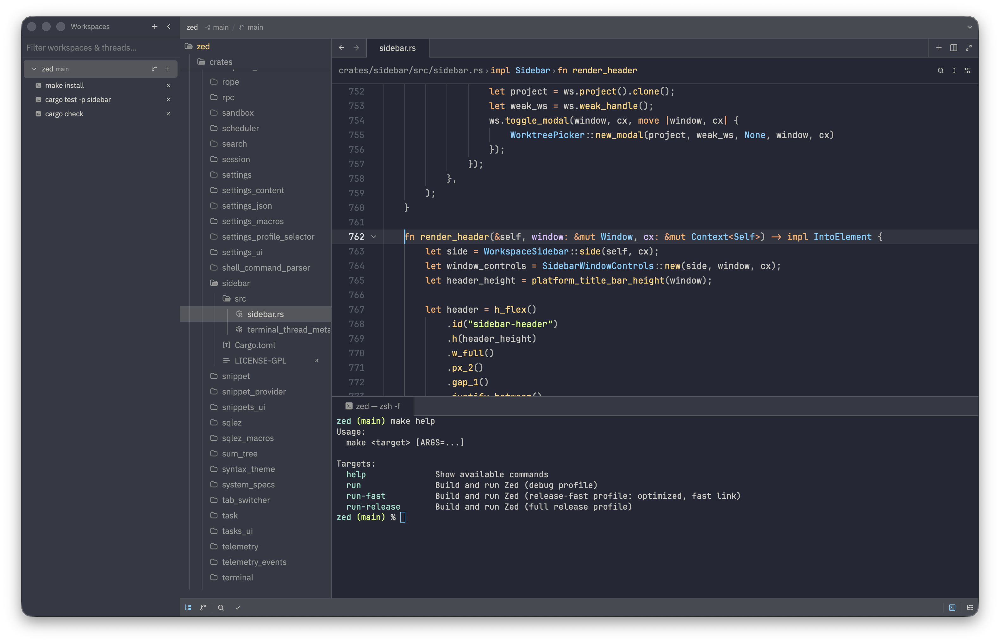
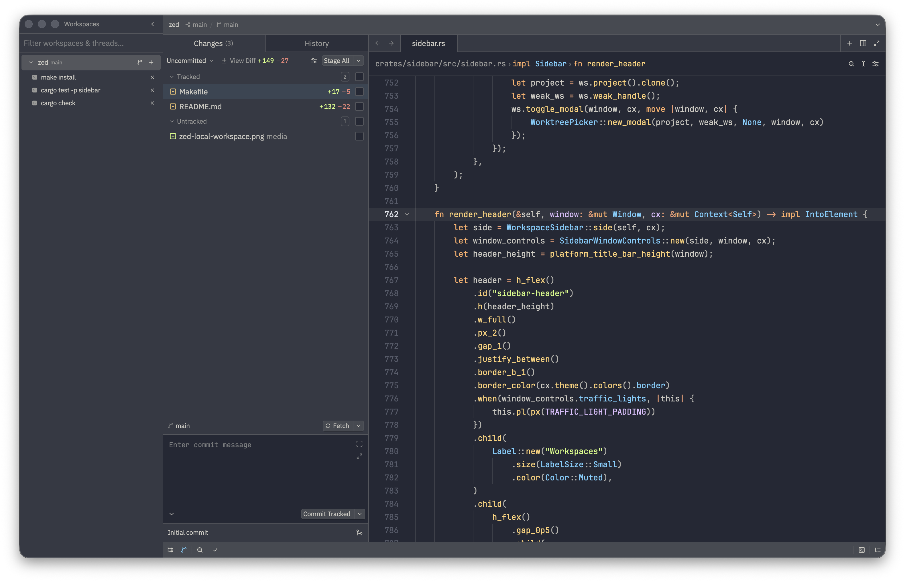

# Zed Local (macOS)

A personal, local-only macOS build of the [Zed](https://github.com/zed-industries/zed) code editor. It keeps the GPU-accelerated GPUI (Apple Metal) core and strips out AI, cloud collaboration, voice/audio, telemetry, and non-macOS subsystems.



## Why This Fork Exists

Upstream Zed bundles AI agents, LLM providers, multiplayer collaboration, voice chat, and cross-platform backends. Its multi-workspace sidebar is also tied to AI settings—turning AI off disables the sidebar.

This build strips Zed down to a fast local macOS editor:

- **No AI or cloud bloat:** Removed 92 crates and ~881k lines of code (AI/LLM stack, collaboration, audio, telemetry, auto-updater, non-macOS backends, and extra modes).
- **Standalone multi-workspace sidebar (`crates/sidebar`):** Rebuilt without AI dependencies to manage multiple local projects, Git worktrees, and persistent per-project terminal threads in one window.
- **Core editing intact:** GPUI on Metal, Tree-sitter, LSP, Git panel, inline diffs, multi-buffer search, tasks, integrated terminal, and full compatibility with `~/.config/zed`.
- **Single-command local install:** Build, sign, install `/Applications/Zed.app`, and link `/opt/homebrew/bin/zed` via `make install`.

## Footprint vs. Upstream Zed

| Metric | Upstream Zed | Zed Local (macOS) | Difference |
| --- | --- | --- | --- |
| Repository size (excluding `target/`) | ~530 MB | ~78 MB | -85% |
| Rust source tree (`crates/`) | 89 MB | 48 MB | -46% |
| Workspace crates | ~255 | 163 | -92 crates |
| Lines of code removed | — | 881,356 | — |
| AI / LLM crates | 41 | 0 | Removed |
| Target platform | macOS, Linux, Windows, Web, iOS | macOS (Metal) | macOS only |

### What Was Removed

- **AI & LLM stack (41 crates):** Agent UI, Copilot, model providers, prompt store, edit prediction, and web search.
- **Collaboration & audio (6 crates):** Multiplayer server, channels, voice calls, LiveKit, and WebRTC audio.
- **Non-macOS backends (11 crates):** Linux, Windows, Web, iOS, WGPU, Linux sandbox, and Windows resources.
- **Background services (6 crates):** Auto-updater, crash handler, hang telemetry, feedback, and onboarding.
- **Extra modes & CI tooling (28+ crates):** Vim mode, debugger UI, REPL, dev containers, benchmarks, eval CLIs, docs generator, and CI workflows.

## Workspace Sidebar & Git Workflow



The rebuilt sidebar (`crates/sidebar`, toggled with `Cmd+Option+J`) runs without AI and handles:

- **Multi-project switching:** Switch between local projects in a single window. Restored projects from previous sessions load lazily when selected.
- **Git worktrees:** Click the branch icon next to any project to open the Git worktree picker and create or switch worktrees.
- **Persistent terminal threads:** Click `+` next to a project to create a named terminal thread. Thread metadata is persisted in SQLite (`sidebar_terminal_threads`) and grouped under its project.

## Prerequisites (macOS)

1. Install Xcode from the App Store.
2. Install the Apple Metal Toolchain:
   ```sh
   xcodebuild -downloadComponent MetalToolchain
   ```
3. Install `cmake`:
   ```sh
   brew install cmake
   ```
4. Install `rustup` (Cargo picks up the toolchain from [`rust-toolchain.toml`](./rust-toolchain.toml)).

## Build & Install

```sh
make install
```

This builds the release `zed` and `cli` binaries, bundles `/Applications/Zed.app`, and symlinks `/opt/homebrew/bin/zed`. Launch the app directly or open a directory from your terminal:

```sh
zed .
```

After making local changes, run `make install` again, quit Zed (`Cmd+Q`), and reopen it.

## Top `zed` CLI Commands

Once installed (`make install` links `/opt/homebrew/bin/zed`), use the CLI from any terminal:

| Command | What it does |
| --- | --- |
| `zed .` | Open the current directory. |
| `zed src/main.rs:42:10` | Open a file at line `42`, column `10`. |
| `zed -a file1.rs file2.rs` | Add files or folders to the currently open workspace. |
| `zed -n path/to/project` | Open in a new Zed window. |
| `zed -e path/to/file.rs` | Open in the existing Zed window. |
| `zed -w path/to/file` | Wait until the file/window is closed (useful for `GIT_EDITOR="zed -w"`). |
| `zed --diff old.rs new.rs` | Open a side-by-side diff (works on files or entire directories). |
| `git diff \| zed -` | Pipe stdin directly into a new editor buffer. |
| `zed --foreground` | Run Zed in the foreground with live logs for debugging. |
| `zed --user-data-dir /tmp/zed .` | Launch with an isolated database and config directory. |
| `zed --completions zsh` | Generate shell completions (`zsh`, `bash`, `fish`, `nushell`). |

## Top Keyboard Shortcuts (macOS)

Default macOS keymap (`Cmd+K Cmd+S` to view or customize your keymap; `Cmd+Option+,` to edit `settings.json`).

### Workspace Sidebar & Panels

| Shortcut | Action |
| --- | --- |
| `Cmd+Option+J` | Toggle Workspace Sidebar |
| `Cmd+Option+;` | Focus Workspace Sidebar (filter workspaces & threads) |
| `Cmd+Ctrl+W` | Open Git Worktree Picker |
| `Cmd+Shift+E` | Focus Project Panel |
| `Ctrl+Shift+G` | Focus Git Panel |
| ``Ctrl+` `` | Toggle Integrated Terminal |
| `Cmd+B` / `Cmd+J` | Toggle Left Dock / Bottom Dock |
| `Cmd+O` | Open project or file |

### Navigation & Search

| Shortcut | Action |
| --- | --- |
| `Cmd+P` | Quick open file (File Finder) |
| `Cmd+Shift+P` | Command Palette |
| `Cmd+Shift+O` | Jump to symbol in current file |
| `Cmd+T` | Jump to symbol across project |
| `Cmd+F` / `Cmd+Shift+F` | Find in file / Search across project |
| `Cmd+Shift+M` | Open Diagnostics panel |
| `Ctrl+Tab` | Switch between recent tabs |

### Editing, Panes & Tasks

| Shortcut | Action |
| --- | --- |
| `F12` / `Cmd+F12` | Go to definition / Go to type definition |
| `F2` | Rename symbol |
| `Cmd+D` | Select next match (multi-cursor) |
| `Cmd+\` | Split pane right |
| `Cmd+W` / `Cmd+Shift+T` | Close tab / Reopen closed tab |
| `Cmd+Shift+R` / `Cmd+Option+R` | Spawn task / Rerun last task |
| `Cmd+,` / `Cmd+Option+,` | Open Settings / Open `settings.json` |

## Common Build Commands

Run `make help` to see all targets in [`Makefile`](./Makefile):

| Command | Description |
| --- | --- |
| `make run` | Build and run Zed (debug profile). |
| `make run-fast` | Build and run Zed (`release-fast` profile). |
| `make run-release` | Build and run Zed (full `release` profile). |
| `make open` | Launch the already-built debug binary without running Cargo. |
| `make check` | Fast `cargo check` for `zed`. |
| `make check-sidebar` | Fast `cargo check` for `sidebar` and `workspace`. |
| `make build` | Build the debug `zed` binary. |
| `make build-release` | Build release `zed` and `cli` binaries. |
| `make bundle` | Create `target/bundle/Zed.app` with icons, `Info.plist`, and ad-hoc signature. |
| `make install` | Build, install `/Applications/Zed.app`, and link `/opt/homebrew/bin/zed`. |
| `make test` | Run unit tests in `crates/sidebar`. |
| `make fmt` | Format Rust source files with `cargo fmt`. |
| `make clippy` | Run Clippy on `zed` and `sidebar`. |
| `make clean-debug` | Remove `target/debug` to reclaim disk space. |
| `make size` | Show disk usage for `.git`, `crates`, `target`, and the root volume. |

## Project Layout

- [`crates/zed`](./crates/zed) — macOS application entry point, menus, and window setup.
- [`crates/sidebar`](./crates/sidebar) — Rebuilt multi-workspace sidebar (projects, Git worktrees, terminal threads).
- [`crates/workspace`](./crates/workspace) — Multi-workspace host, panes, docks, status bar, and SQLite persistence.
- [`crates/cli`](./crates/cli) — `zed` CLI launcher that connects to `/Applications/Zed.app`.
- [`crates/gpui`](./crates/gpui) & [`crates/gpui_macos`](./crates/gpui_macos) — Native macOS Metal UI framework.
- [`Makefile`](./Makefile) — Local build, bundling, and installation targets.

## License

Licensed under [GPL-3.0-or-later](./LICENSE-GPL) and [Apache-2.0](./LICENSE-APACHE) where marked.
