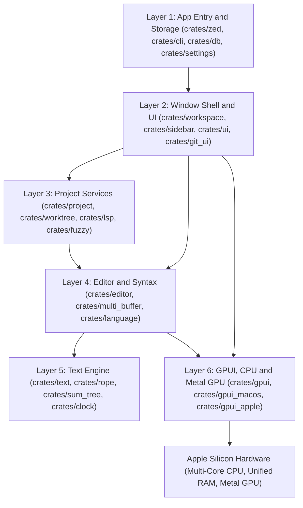
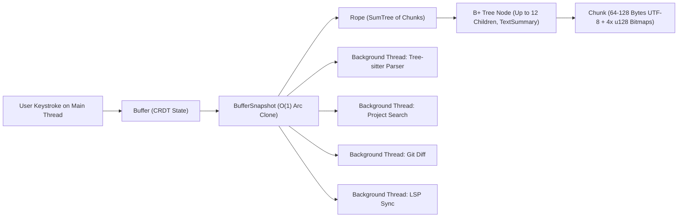
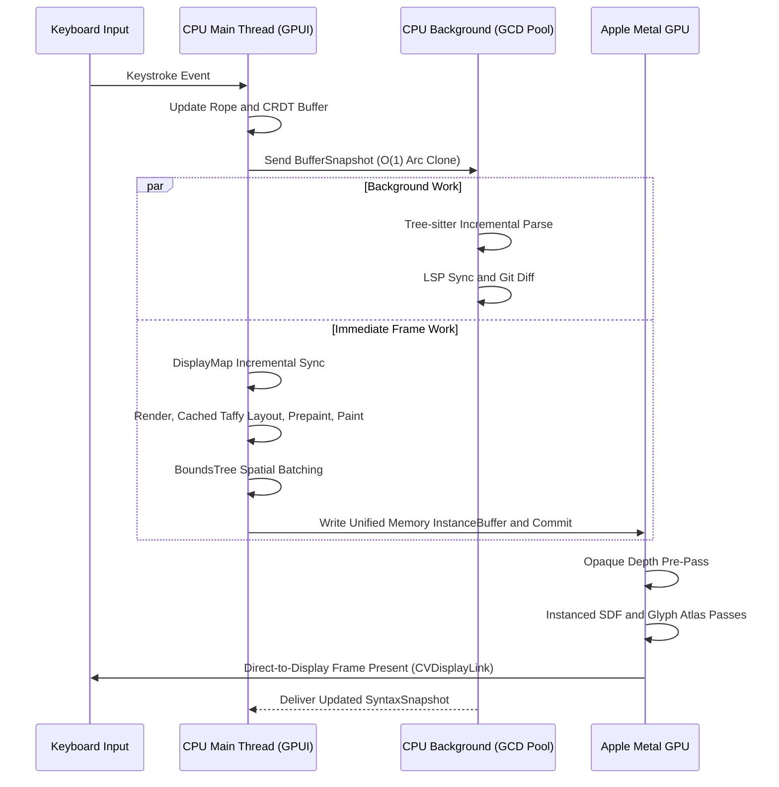
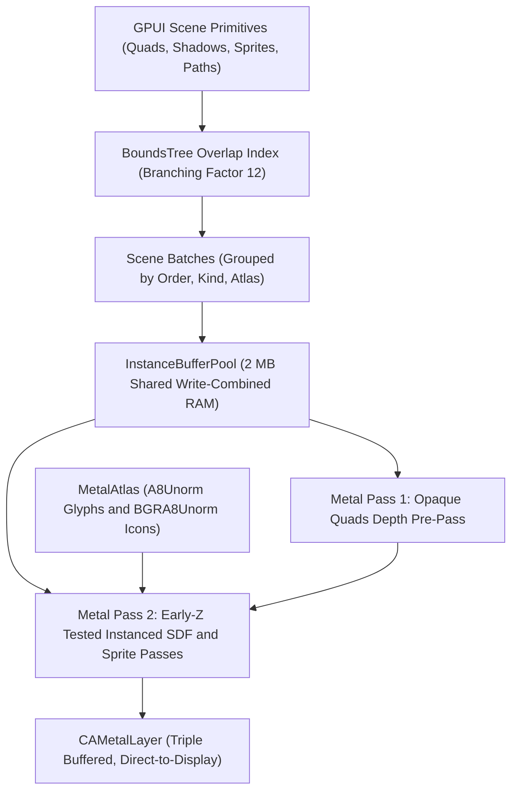

# Zed Architecture Guide (High Level to Low Level)

## 1. Purpose and Scope

This document explains how Zed engineers design and build the Zed code editor.
It starts at the high-level application layer and goes down to CPU threads, memory layout, and Metal GPU shaders.
It also explains the engineering techniques that make Zed fast.

This repository (`Zed Local` for macOS) contains the core Zed engine on Apple Metal.
It keeps the Rust text engine, `GPUI` framework, Tree-sitter parser, LSP client, and Metal renderer.
It removes AI, cloud collaboration, audio, and non-macOS platform backends.

This document follows **ASD-STE100** (Simplified Technical English) rules:

- Each sentence states one clear idea.
- Sentences stay short and direct.
- Verbs use active voice and simple present tense.
- Technical names (`SumTree`, `Rope`, `GPUI`, `CRDT`, `SDF`) keep one consistent meaning.

---

## 2. High-Level System Architecture

Zed uses a modular Rust workspace with 163 crates in `crates/`.
Engineers split the editor into six vertical layers.
Higher layers manage windows, projects, and user workflows.
Lower layers manage text trees, CPU scheduling, and GPU drawing.

### 2.1 Application Ownership Model

In `GPUI` (`crates/gpui`), one root object called `App` owns all application state.
Views and data models live inside `App` as entities (`Entity<T>`).
An `Entity<T>` handle holds an identifier and a reference count.
Code reads or updates an entity only through a reference to `App` or `Context<T>`.

This centralized model avoids complex shared-lock graphs across UI widgets.
When an entity changes its state, it calls `cx.notify()` or `cx.emit(event)`.
`GPUI` triggers only the subscribed observers and marks affected views for redraw.

### 2.2 Workspace, Project, and Sidebar Hierarchy

Each macOS window hosts a `MultiWorkspace` (`crates/workspace`).
A `MultiWorkspace` manages one or more `Workspace` objects and an optional `Sidebar` (`crates/sidebar`).
Each `Workspace` owns:

- A `PaneGroup` tree that splits the window into `Pane` tabs.
- Three `Dock` areas (left, right, and bottom) for panels such as `ProjectPanel`, `GitPanel`, and `Terminal`.
- One `Project` (`crates/project`) that coordinates `BufferStore`, `WorktreeStore`, `LspStore`, and `GitStore`.
- A SQLite database (`crates/sqlez`, `crates/db`) that stores window layouts, recent workspaces, and terminal threads.

`MultiWorkspace` loads restored projects lazily when the user selects them in the sidebar.
This lazy load keeps startup time short even when many projects exist in the session.

---

## 3. Core Data Structures (Text, Rope, and SumTree)

A fast code editor cannot store a large file as one flat byte array.
Inserting one character at the top of a 50 MB array shifts 50 million bytes in memory.
Zed solves this problem with three stacked data structures: `SumTree`, `Rope`, and CRDT `Buffer`.

### 3.1 SumTree: Copy-on-Write B+ Tree

`SumTree<T>` (`crates/sum_tree/src/sum_tree.rs`) is the core tree structure across Zed.
Zed uses `SumTree` for text chunks, syntax layers, display maps, folds, inlays, and file worktrees.

`SumTree` achieves high speed through four design choices:

- **High branching factor**: `TREE_BASE` equals 6, so each node holds up to 12 items or child trees. A wide tree stays shallow and reduces CPU cache misses.
- **Inline fixed arrays**: Each node stores items and summaries in inline `ArrayVec` buffers instead of heap-allocated `Vec` objects.
- **Multi-dimensional summaries**: Each node stores a `Summary` of all items below it. A cursor searches any `Dimension` (bytes, UTF-16 units, lines, or keys) in `O(log n)` time.
- **Structural sharing with `Arc`**: Every node sits inside an `Arc<Node<T>>`. Cloning a `SumTree` increments one atomic counter in `O(1)` time. Editing copies only the nodes along one root-to-leaf path.

### 3.2 Rope and 128-Byte Bitmapped Chunks

`Rope` (`crates/rope/src/rope.rs`) wraps a `SumTree<Chunk>`.
Each `Chunk` (`crates/rope/src/chunk.rs`) stores 64 to 128 bytes of UTF-8 text (`MIN_BASE = 64`, `MAX_BASE = 128`) in an inline `ArrayString<128, u8>`.

Inside each `Chunk`, Zed stores four 128-bit bitmaps (`u128`):

- `chars`: Sets bit `i` when byte `i` starts a UTF-8 character.
- `chars_utf16`: Sets bits so the popcount equals the UTF-16 code unit count (required by LSP servers).
- `newlines`: Sets bit `i` when byte `i` is an ASCII newline (`\n`).
- `tabs`: Sets bit `i` when byte `i` is an ASCII tab (`\t`).

The CPU counts lines, validates UTF-8 boundaries, and converts UTF-8 to UTF-16 offsets with single-cycle bit shifts and `count_ones` instructions.
The CPU does not scan text byte by byte during coordinate conversion.

### 3.3 CRDT Buffer and Lock-Free Snapshots

`Buffer` (`crates/text/src/text.rs`) builds a Conflict-Free Replicated Data Type (CRDT) on top of `Rope` and `SumTree`.
Each edit receives a Lamport timestamp (`crates/clock`) and an immutable `Anchor` position.
`Anchor` points stay valid even after other edits insert or delete text earlier in the file.

`Buffer` stores its current text state inside `BufferSnapshot`:

- `visible_text: Rope` holds the current file content.
- `deleted_text: Rope` holds deleted text for undo history and conflict resolution.
- `fragments: SumTree<Fragment>` tracks CRDT fragment metadata.
- `insertions: SumTree<InsertionFragment>` indexes edit origins.

Because every field inside `BufferSnapshot` uses copy-on-write `Arc` trees, cloning a `BufferSnapshot` takes `O(1)` time and copies zero text bytes.
Background threads read immutable snapshots without mutex locks while the main thread accepts new keystrokes.

---

## 4. Editor Display Pipeline and Syntax Engine

An editor rarely draws raw file bytes directly.
It adds visual features on top of the file text.
These features include multi-file excerpts, inlay hints, folds, expanded tabs, soft wraps, diagnostics, and syntax colors.

### 4.1 MultiBuffer

`MultiBuffer` (`crates/multi_buffer`) joins slices (excerpts) from one or many `Buffer` objects into one continuous text surface.
A normal file tab uses a `MultiBuffer` with one excerpt.
Project search results and multi-file diffs use a `MultiBuffer` with many excerpts.
Edits in a `MultiBuffer` route directly back to the underlying `Buffer` objects.

### 4.2 Stacked Incremental DisplayMap

`DisplayMap` (`crates/editor/src/display_map.rs`) transforms `MultiBuffer` coordinates into visual screen rows through six stacked layers.
Each layer stores a `SumTree` of transforms.
Unchanged regions use a single `Isomorphic` pass-through transform.
Changed regions hold layer-specific transforms (such as an injected inlay hint or a soft wrap break).

```mermaid
flowchart LR
    MB["MultiBuffer (Raw Excerpts)"] --> IM["InlayMap (Type and Parameter Hints)"]
    IM --> FM["FoldMap (Collapsed Code Ranges)"]
    FM --> TM["TabMap (Hard Tabs to Spaces)"]
    TM --> WM["WrapMap (Soft Line Wrapping)"]
    WM --> BM["BlockMap (Diagnostics, Diffs, Headers)"]
    BM --> DM["DisplayMap (Syntax and Selection Highlights)"]
    DM --> EE["EditorElement (Visible Viewport Rows Only)"]
```

When a user types one character, `MultiBuffer` sends a small `Edit` range up the stack.
Each layer calls `sync()` and recalculates only the affected slice in `O(log n)` time.
Each layer produces an immutable snapshot (`InlaySnapshot`, `FoldSnapshot`, `WrapSnapshot`, `BlockSnapshot`, `DisplaySnapshot`).
`EditorElement` (`crates/editor/src/element.rs`) reads only the visible viewport rows from `DisplaySnapshot` instead of laying out the whole file.

### 4.3 Incremental Tree-sitter Syntax Engine

`SyntaxMap` (`crates/language/src/syntax_map.rs`) parses source code with Tree-sitter on background threads.

- **Incremental reparsing**: Tree-sitter reuses unchanged syntax subtrees after each edit.
- **Nested language injections**: `SyntaxSnapshot` stores language layers in a `SumTree`. For example, it parses JavaScript and CSS blocks inside an HTML file.
- **Bounded highlight queries**: Queries limit byte windows (`MAX_BYTES_TO_QUERY = 16 KiB`) so syntax highlighting stays fast on huge minified files.
- **Background deallocation**: Deep Tree-sitter C trees take a long time to free. `SyntaxSnapshot::drop` sends dropped trees over an `mpsc` channel to a background thread (`SyntaxSnapshot::drop`).

---

## 5. CPU Architecture: Concurrency, Memory, and Layout

Zed keeps the main UI thread light so every frame meets 120 Hz ProMotion timing (8.33 ms per frame).
It moves heavy computation to background CPU cores and minimizes heap allocation churn.

### 5.1 Multi-Core Threading Model

`GPUI` provides two distinct executors (`crates/gpui/src/executor.rs`):

- **`ForegroundExecutor`**: Runs tasks on the macOS main thread (`DispatchQueue::main()`). It handles input events, entity updates, layout, and Metal command encoding.
- **`BackgroundExecutor`**: Runs `Send` futures across macOS Grand Central Dispatch global worker queues (`crates/gpui_apple/src/dispatcher.rs`). Tasks choose `Priority::High`, `Priority::Medium`, or `Priority::Low`.

Zed also uses `rayon` data-parallelism inside `crates/sum_tree` and `crates/rope` to build large trees across multiple CPU cores.
File watching and directory scanning (`crates/worktree`) run in background tasks and batch filesystem events (`FS_WATCH_LATENCY = 100 ms`).

### 5.2 Fast Search with Bitmask Pre-Filtering

Fuzzy file and symbol search (`crates/fuzzy`, `crates/fuzzy_nucleo`) ranks hundreds of thousands of paths in a few milliseconds.
Before the full fuzzy scorer runs, Zed filters candidates with `CharBag` (`crates/fuzzy/src/char_bag.rs`).

`CharBag` packs character frequencies into a single 64-bit integer (`u64`):

- Bits 0 to 51 store 2-bit saturating counts for ASCII letters `a` to `z`.
- Bits 52 to 61 store presence bits for digits `0` to `9`.
- Bit 62 stores the `-` character.

To test a candidate path, the CPU runs one bitwise check: `(candidate & query) == query`.
This check rejects most non-matching paths in a few CPU cycles before it allocates score matrices.

### 5.3 Memory Allocator and Per-Frame Bump Arena

Zed reduces allocator overhead at two levels:

- **Global allocator**: `crates/zed/src/main.rs` sets `mimalloc` (`mimalloc::MiMalloc`) as the global allocator. `mimalloc` uses thread-local free lists and lowers lock contention across background worker threads.
- **Per-frame element arena**: `GPUI` builds a fresh element tree on each frame. `GPUI` does not call `malloc` and `free` for each UI box. Instead, it allocates elements sequentially inside a bump-pointer `Arena` (`crates/gpui/src/arena.rs`). When the frame ends, `Arena::force_clear()` runs destructors and resets chunk offsets in one fast pass.

### 5.4 GPUI Hybrid Frame Loop and Cached Taffy Layout

`GPUI` combines retained entity state with immediate-mode element rendering (`crates/gpui/src/element.rs`).
On each frame, a window runs four CPU stages before it sends work to the GPU:

1. **Render**: Dirty views call `Render::render()` to emit a tree of `Element` objects into the bump arena.
2. **Request Layout**: Elements submit CSS Flexbox and Grid styles to `TaffyLayoutEngine` (`crates/gpui/src/taffy.rs`). `TaffyLayoutEngine` keeps Taffy nodes alive across frames in a `LayoutCache` so Taffy skips unchanged subtrees.
3. **Prepaint**: Elements receive final pixel `Bounds`, register mouse hitboxes, and shape visible text lines.
4. **Paint**: Elements push low-level draw primitives (`Quad`, `Shadow`, `Underline`, `MonochromeSprite`, `PolychromeSprite`, `Path`) into a `Scene` (`crates/gpui/src/scene.rs`).

---

## 6. GPU Architecture: Batching, Atlas, and Metal Pipeline

Traditional Electron editors build a browser DOM, run CSS style cascades, rasterize layers on CPU tiles, and composite them.
Zed replaces the entire browser stack with a custom Metal GPU renderer (`crates/gpui_apple/src/metal_renderer.rs`).
The GPU draws text, backgrounds, borders, shadows, and vector paths directly in a single render pass.

### 6.1 Spatial Batching with BoundsTree

A single GPU draw call has fixed CPU driver overhead.
If the editor sends 5,000 separate draw calls for 5,000 characters, it wastes frame time.
`GPUI` solves this problem. It sorts primitives into large batches and keeps the exact visual overlap order.

When an element paints a primitive into `Scene` (`crates/gpui/src/scene.rs`), `Scene` inserts its bounding rectangle into `BoundsTree` (`crates/gpui/src/bounds_tree.rs`):

- `BoundsTree` is a flat-array R-tree with `MAX_CHILDREN = 12` for high cache locality.
- It tracks `max_leaf` for an `O(1)` fast path when primitives do not overlap.
- If a new primitive does not intersect an existing primitive of a higher kind, it shares the same `DrawOrder`.
- `Scene::batches()` groups all primitives with the same `DrawOrder`, `PrimitiveKind`, and `AtlasTextureId` into one contiguous slice.

As a result, Metal draws thousands of editor glyphs or UI rectangles in just a few instanced draw calls.

### 6.2 CoreText Shaping and GPU Texture Atlas

Text rendering splits work between Apple CoreText on the CPU and the Metal fragment shader on the GPU:

1. **Shaping (`crates/gpui_apple/src/text_system.rs`)**: `AppleTextSystem` calls CoreText (`CTLine`) to convert UTF-8 strings and OpenType features into positioned glyph runs. `GPUI` caches shaped line layouts across frames.
2. **Rasterization**: CoreGraphics rasterizes each unique glyph once into a small bitmap. Zed supports 4 horizontal subpixel offsets (`SUBPIXEL_VARIANTS_X = 4`) for crisp text alignment.
3. **Atlas Packing (`crates/gpui_apple/src/metal_atlas.rs`)**: `MetalAtlas` packs rasterized glyphs, icons, and images into GPU textures using `etagere::BucketedAtlasAllocator`.
   - Monochrome glyphs use compact 1-byte-per-pixel `A8Unorm` textures.
   - Polychrome emojis and images use 4-byte-per-pixel `BGRA8Unorm` textures.
   - Textures start at `1024x1024` and scale up to `16384x16384` as needed.
   - On Apple GPUs, atlas textures use `MTLStorageMode::Shared` so uploads write directly to unified memory.

### 6.3 Pooled Unified Memory Instance Buffers

`MetalRenderer` (`crates/gpui_apple/src/metal_renderer.rs`) uploads all scene primitives for a frame into one Metal `MTLBuffer` per pass.

- `InstanceBufferPool` pre-allocates 2 MB buffers aligned to Metal's 256-byte binding requirement (`INSTANCE_BUFFER_ALIGNMENT = 256`).
- On Apple Silicon (`is_unified_memory`), buffers use `MTLResourceOptions::StorageModeShared | CPUCacheModeWriteCombined`.
- The CPU writes Rust primitive structs (`#[repr(C)]`, zero padding bytes via `PaddedBool32`) straight into unified RAM.
- The GPU reads the same physical RAM without a CPU-to-GPU copy.
- After GPU command completion, a callback returns the buffer to `InstanceBufferPool` for reuse in future frames.

### 6.4 Opaque Depth Pre-Pass and SDF Fragment Shaders

`MetalRenderer` compiles `crates/gpui_apple/src/shaders.metal` into a prebuilt `shaders.metallib` binary at build time.
This avoids shader compilation stutters at app launch.

During `draw_primitives_to_texture()`, Metal executes a two-stage hardware-accelerated pipeline:

1. **Opaque Quad Depth Pre-Pass (`opaque_quads_pipeline_state`)**:
   - The GPU draws solid, unrounded, borderless quads first and writes each quad's `quad_depth` into `depth_texture`.
   - Later blended passes turn on hardware depth testing (`depth_test_state`).
   - The GPU rejects hidden pixels under opaque panels before fragment shaders run. This step removes wasted overdraw.
   - In `quad_vertex`, opaque rectangles return `CULLED_POSITION`. The blended quad pass skips them completely.
2. **Analytical Signed Distance Field (SDF) Shaders**:
   - Rounded rectangles, borders, dashed borders, shadows, and underlines use exact math formulas (`quad_sdf`, `quarter_ellipse_sdf`) in the fragment shader.
   - Each UI element needs only 4 vertices (two triangles). Zed never splits curved corners into dozens of triangles.
   - Plain solid quads set `SIMPLE_PRIMITIVE_FLAG` (`1u << 31`) in the vertex shader. The fragment shader then returns the flat color immediately and skips SDF math.

### 6.5 Frame Pacing and Zero-Rebuild Animations

`MetalRenderer` sets up `CAMetalLayer` for low-latency presentation:

- **Direct-to-display**: Opaque windows call `layer.setOpaque(true)`. macOS presents the Metal drawable directly to the display controller and bypasses extra WindowServer compositing.
- **Triple buffering**: `layer.setMaximumDrawableCount(3)` prevents CPU stalls while the GPU finishes the previous frame.
- **DisplayLink synchronization**: `CVDisplayLink` (`crates/gpui_macos/src/display_link.rs`) aligns frame submission with monitor refresh ticks.
- **Zero-rebuild sprite animations**: `Scene::advance_animations()` (`crates/gpui/src/scene.rs`) updates sprite transform matrices and opacity directly inside the cached `Scene`. Animated spinners and indicators run and skip element rebuilds and Taffy layout.

---

## 7. Summary of Zed Speed Optimizations

The table below maps each major performance technique in Zed to its hardware target, benefit, and source file.

| Technique | Target | Engineering Benefit | Source File |
| --- | --- | --- | --- |
| `SumTree` B+ tree (`TREE_BASE = 6`, `ArrayVec`) | CPU Cache | Shallow tree height and `O(log n)` multi-dimension search | `crates/sum_tree/src/sum_tree.rs` |
| `Arc` copy-on-write `BufferSnapshot` | CPU Multi-Core | `O(1)` lock-free snapshots for background parsing and search | `crates/text/src/text.rs` |
| 128-byte `Chunk` with 4x `u128` bitmaps | CPU ALU | Constant-time newline, UTF-8, and UTF-16 offset math | `crates/rope/src/chunk.rs` |
| Incremental stacked `DisplayMap` | CPU Main Thread | Recalculates only edited slices; layouts visible rows only | `crates/editor/src/display_map.rs` |
| Background `SyntaxSnapshot::drop` thread | CPU Main Thread | Moves slow Tree-sitter C tree deallocation off the UI thread | `crates/language/src/syntax_map.rs` |
| `CharBag` 64-bit fuzzy pre-filter | CPU ALU | Rejects non-matching file paths in one bitwise AND | `crates/fuzzy/src/char_bag.rs` |
| `mimalloc` global allocator | CPU Memory | Low-contention thread-local allocation across worker cores | `crates/zed/src/main.rs` |
| Per-frame bump `Arena` for elements | CPU Memory | Resets transient UI element memory in one pass per frame | `crates/gpui/src/arena.rs` |
| `TaffyLayoutEngine` cross-frame `LayoutCache` | CPU Main Thread | Skips Flexbox and Grid recalculation on unchanged subtrees | `crates/gpui/src/taffy.rs` |
| `BoundsTree` spatial batching | CPU and GPU | Merges thousands of non-overlapping primitives into few draw calls | `crates/gpui/src/bounds_tree.rs` |
| `MetalAtlas` (`etagere` + `A8Unorm`) | GPU VRAM | Packs rasterized glyphs once; draws text as instanced quads | `crates/gpui_apple/src/metal_atlas.rs` |
| Pooled write-combined unified `MTLBuffer` | RAM and GPU | Zero-copy CPU-to-GPU primitive upload on Apple Silicon | `crates/gpui_apple/src/metal_renderer.rs` |
| Opaque quad depth pre-pass | GPU Fragment | Rejects occluded pixels via hardware depth testing | `crates/gpui_apple/src/metal_renderer.rs` |
| SDF fragment shaders + `SIMPLE_PRIMITIVE_FLAG` | GPU Vertex/Frag | Renders rounded borders and shadows with 4 vertices per box | `crates/gpui_apple/src/shaders.metal` |
| Precompiled `shaders.metallib` | Startup Latency | Eliminates runtime shader compilation stalls on launch | `crates/gpui_apple/src/metal_renderer.rs` |
| `Scene::advance_animations()` | CPU Main Thread | Animates sprites without rebuilding elements or layout | `crates/gpui/src/scene.rs` |
| Opaque `CAMetalLayer` + triple buffering | Display Pipeline | Enables macOS direct-to-display presentation at 120 Hz | `crates/gpui_apple/src/metal_renderer.rs` |
